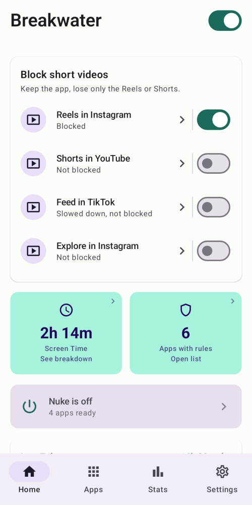
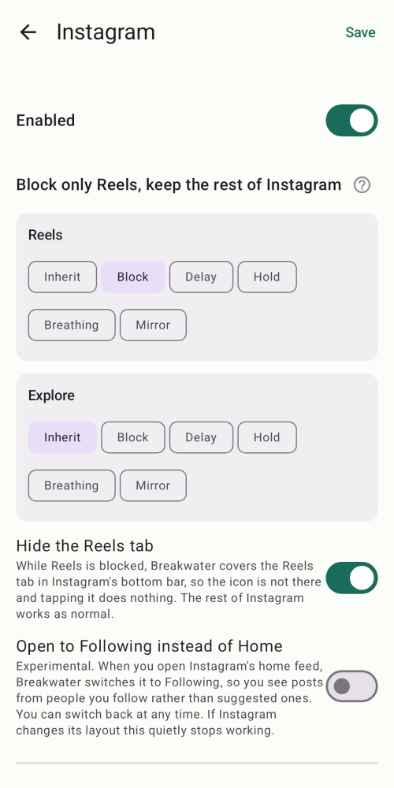
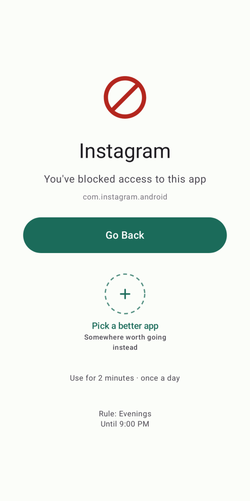
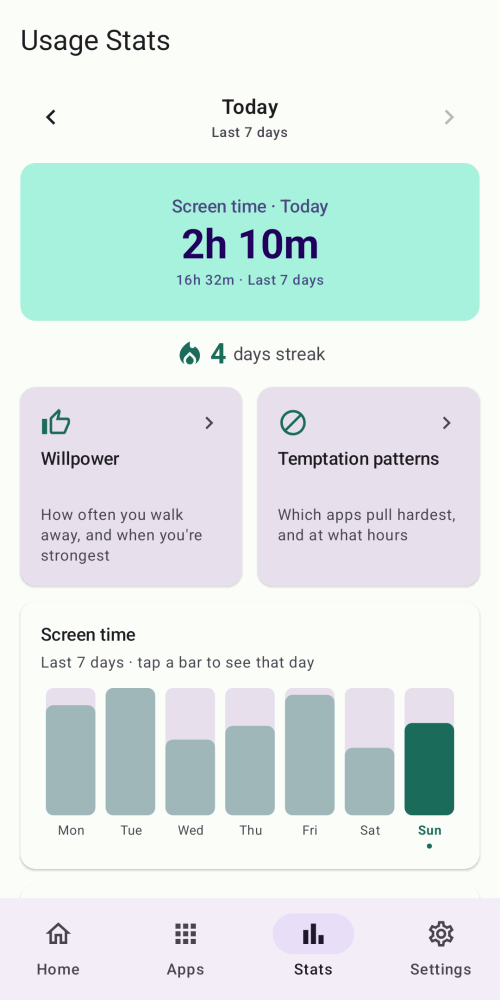
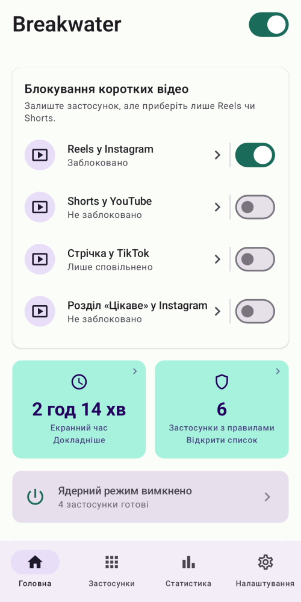
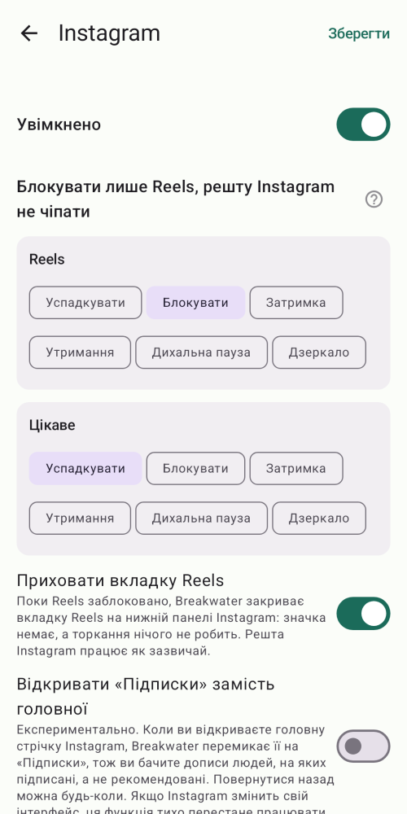
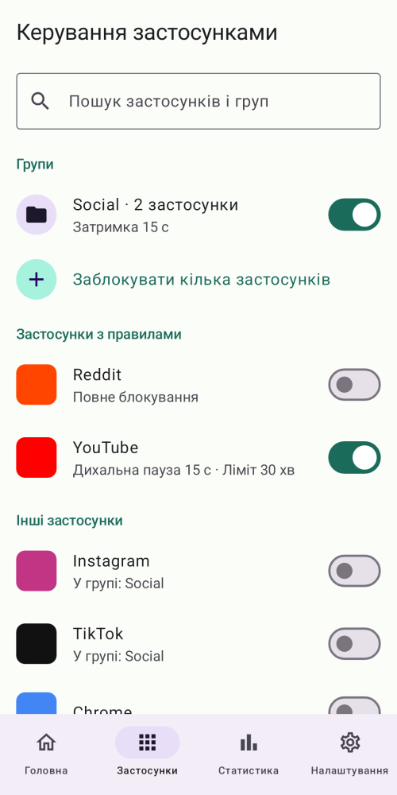
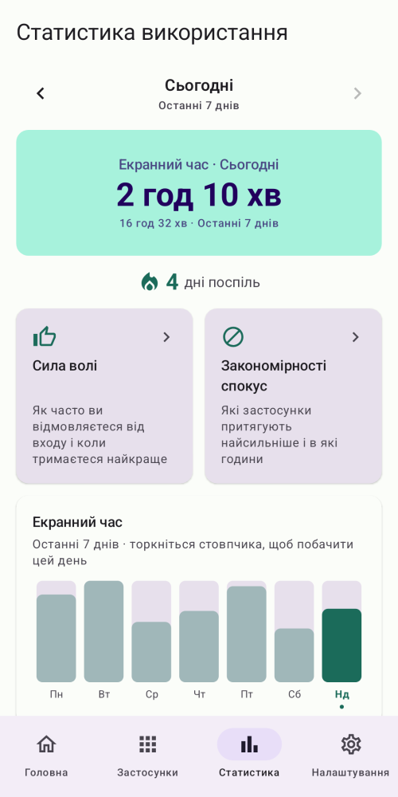
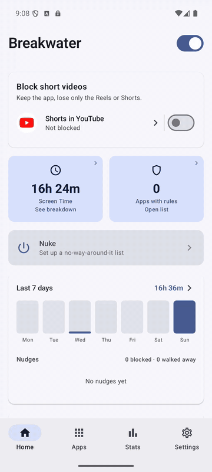

<h1 align="center">Breakwater</h1>

<p align="center">
  <a href="LICENSE"></a>
  
  
  
</p>

<p align="center">
  <b>A privacy-first, open-source app blocker for Android. Keep the app, lose the Reels and Shorts.</b><br>
  A fork of <a href="https://github.com/astraedus/nudge">Nudge</a> by <a href="https://github.com/Antimatter543">@Antimatter543</a>, with a simpler layout and a full Ukrainian translation. Always free, fully offline.
</p>

---

<p align="center">
  
  
  
  
</p>

<p align="center"><b>Українською</b> — the whole app is translated into Ukrainian and follows the phone's or the app's language.</p>

<p align="center">
  
  
  
  
</p>

<p align="center">
  
</p>

## What Breakwater changes from Nudge

- **Easier to find the important switches.** A bottom bar (Home, Apps, Stats, Settings) and a "Block short videos" card on Home with one switch each for Instagram Reels, YouTube Shorts, the TikTok feed and Instagram Explore. The app editor shows the Reels/Shorts section first.
- **Ukrainian translation** of every screen, notification, widget and block screen.
- **Harder to talk yourself out of.** With Strict Mode on, lowering the challenge difficulty or switching off a Reels/Shorts block needs the unlock challenge too, and the guard that keeps you out of the system settings that would disable the app also recognises Ukrainian system screens.
- Its own install ID (`dev.ifurs.breakwater`), so it can be installed next to the Play Store or F-Droid Nudge.

Everything else is Nudge, and Breakwater merges Nudge's updates regularly. Developer notes for this fork: [`FORK.md`](FORK.md).

## Why (in the words of Nudge's author)

> This app is the product of a disdain for subscription services for things that should be free, a disdain for all infinite scrolling short content and about 2 doses of ritalin built over a weekend.
>
> App blockers ask for Accessibility Service permissions. It can see everything on your screen. **Everything.** Most app blockers are closed-source. Some have been [acquired by data intelligence companies](https://sensortower.com/blog/actiondash-stayfree-acquisition-announcement). [...]
>
> I personally use this app because it puts **intention** at the forefront of your mind. It doesn't necessarily block an app, but instead can ask you to wait 15 seconds before it opens. That's it. And that is enough to completely break subconscious behaviours by forcing your conscious self to acknowledge it.

The full story is in [Nudge's README](https://github.com/astraedus/nudge#why).

Breakwater is open source, requests zero internet permissions, and keeps all your data on your device. You can read every line of code.

## Features

### Core blocking

- **Delay-to-open** -- Before opening a blocked app, you wait through a breathing exercise or countdown timer. Not a hard lock -- a moment of friction that breaks the autopilot habit loop.
- **Hard blocking** -- Completely block apps you don't want to access at all.
- **Hold mode** -- The countdown only runs while your finger is on the screen.
- **Mirror mode** -- Instead of a block screen, the wait shows you your own face through the front camera. Preview only, never recorded or saved; without the camera it falls back to the normal countdown.
- **Daily time budgets** -- Allow 30 minutes of Instagram per day, then block. You choose the limit.
- **App groups** -- Create a "Social Media" group, configure once, apply to all.
- **Nuke Mode** -- A separate list of apps that simply do not open until you scan a QR code or barcode you keep somewhere inconvenient.

### Block short videos, keep the app

- **YouTube Shorts** -- block the Shorts feed, keep everything else.
- **Instagram Reels** -- block the Reels player wherever it opens (Reels tab, a reel from a DM or the feed, a profile, Explore), keep DMs and posts. On some newer devices and Instagram builds only the full-screen Reels viewer is detected ([upstream #18](https://github.com/astraedus/nudge/issues/18)).
- **Instagram Explore** and **TikTok For You** -- block the algorithm, keep the app.
- **Hide the Reels tab** -- covers the Reels icon in Instagram's bottom bar while Reels is blocked.

### Smart features

- **Schedule rules** -- Block apps on specific days and times, including overnight schedules and "first unlock + N minutes".
- **Strict Mode** -- Turning protection off or weakening a rule needs a typed challenge.
- **Interaction counter and auto-kick** -- See how many reels you scrolled, and get sent home after N.
- **Grayscale mode** -- Make apps less appealing.
- **A better app** -- Pick one app the block screen offers instead.
- **"Walked Away" tracking** -- Every time you choose to leave instead of waiting, Breakwater counts it.
- **Home-screen widgets** and **export/import** of rules and settings.

### Privacy

- **Zero internet permission** -- Declared in the manifest, and a build check fails if any library tries to add it.
- All data stored locally (Room DB + DataStore). Nothing leaves your device.
- No analytics, no telemetry, no crash reporting, no third-party SDKs.
- Open source under GPL-3.0. Read the [privacy policy](PRIVACY.md).

## Install

There is no Breakwater release yet; build it from source (below). When releases appear they will be on [GitHub Releases](https://github.com/ifurs/breakwater/releases), which [Obtainium](https://github.com/ImranR98/Obtainium) can track.

The original Nudge, in English only, is on [Google Play](https://play.google.com/store/apps/details?id=dev.astraedus.nudge) and [F-Droid](https://f-droid.org/packages/dev.astraedus.nudge/). Breakwater installs next to it; to move your rules, export them in Nudge's Settings and import them in Breakwater.

### Build from source

```bash
git clone https://github.com/ifurs/breakwater.git
cd breakwater
export ANDROID_HOME=$HOME/Android/Sdk  # or your SDK path
./gradlew assembleDebug
adb install -r app/build/outputs/apk/debug/app-debug.apk
```

Requires JDK 17 or 21 and the Android SDK with platform 36. After installing, turn on Breakwater's accessibility service; a sideloaded app may first need App info → ⋮ → *Allow restricted settings*.

## How the blocking works

```
AccessibilityService detects foreground app change
  -> BlockEngine evaluates rules for that app
  -> If in-app rules exist: InAppDetector inspects navigation state
     (checks resource IDs to identify Shorts/Reels; Instagram Reels is recognised
     by the reel player's own container, not by which bottom tab is selected)
  -> Decision: ALLOW | HARD_BLOCK | DELAY | HOLD | BREATHING | MIRROR
  -> If blocked: full-screen overlay appears
  -> User can wait through the timer, or go back home
  -> After delay/breathing completes: passthrough until user leaves the app
```

The delay and breathing modes are the core idea. They don't lock you out -- they insert a moment of intentional friction, which is often enough to break the automatic habit loop.

## Permissions

| Permission | Why | What it sees |
|-----------|-----|-------------|
| **Accessibility Service** | Detects the foreground app and in-app navigation (Shorts, Reels) | Package name of the foreground app, plus UI element IDs and selection state for in-app feature detection. Does **not** read arbitrary text, keystrokes, or notification content. See the [privacy policy](PRIVACY.md). |
| **Display Over Other Apps** | Shows the block/delay overlay on top of blocked apps | Nothing. It's a display permission. |
| **Usage Stats** | Tracks your daily screen time per app for time budgets | App usage durations, stored locally. |

No internet permission. No contacts. No location. No storage. The camera is used only for Mirror mode, the optional block-screen camera and scanning a Nuke key, and only as a live preview: nothing is recorded or saved.

## Tech stack

- Kotlin + Jetpack Compose + Material 3
- Hilt (dependency injection), Room (local database), DataStore (preferences)
- Coroutines + Flow
- Clean Architecture: `domain/` has zero Android imports and is unit-tested on the JVM
- Min SDK 26 (Android 8.0), target SDK 36

## Running tests

```bash
./gradlew :app:testDebugUnitTest      # JVM tests, no device needed
./gradlew lintDebug                   # catches API calls above minSdk 26
./gradlew :app:verifyPaparazziDebug   # screenshot tests, English and Ukrainian
```

## Contributing

Issues and PRs are welcome at [ifurs/breakwater](https://github.com/ifurs/breakwater/issues). Ukrainian wording follows [`docs/i18n.md`](docs/i18n.md). Fixes that are not specific to this fork are better sent to [Nudge](https://github.com/astraedus/nudge) itself, so everyone gets them.

## License

[GPL-3.0](LICENSE), like Nudge. Breakwater is based on [Nudge](https://github.com/astraedus/nudge), © its authors.
